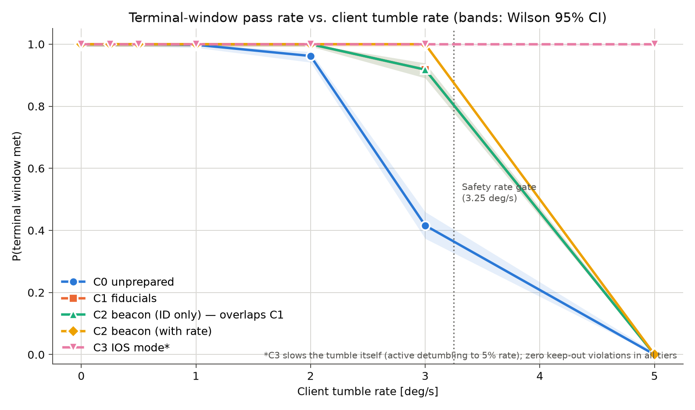

# The Project in Plain Language

**Audience:** everyone — managers, business and policy colleagues, students, new team members. No maths or programming needed.

---

## 1. The problem in one paragraph

Thousands of satellites circle the Earth. Some of the most valuable sit 36 000 km up in *geostationary orbit*, where they relay TV, internet and weather data. When one runs low on fuel or partly breaks, a robotic "space tug" could fly up to it, grab it, and refuel, repair or remove it. The hard part is the last few metres: the broken satellite may be **slowly spinning**, its markings may be hard to see, and the tug's cameras and thrusters are never perfect. This project asks a practical question:

> **If satellite makers add small "be-serviceable" features today — visual markers, a small radio beacon, a cooperative mode — how much safer and more reliable does a future rescue become?**

## 2. The cast

| | What it is | Everyday comparison |
|:--|:--|:--|
| **Client** | The satellite that needs help. It may be tumbling (spinning out of control). | A boat drifting and turning in a current. |
| **Servicer** | Our robotic tug with cameras and small thrusters. | A rescue boat trying to come alongside. |
| **Capture fixture** | A handle on the client, 1.5 m from its centre, that the tug must reach. | The ladder on the side of the drifting boat — it moves as the boat turns. |
| **Keep-out sphere** | An invisible 1.35 m safety bubble around the client that the tug must never enter. | "Don't touch the hull." |
| **Service Beacon** | A small radio on the client that tells the tug who it is and how fast it is spinning. | The drifting boat shouting "I'm turning at 3 degrees per second!" |

## 3. Four levels of preparation

We compare clients that were prepared for servicing to different degrees:

| Tier | What the client has | What that means for the tug |
|:--|:--|:--|
| **C0 — Unprepared** | Nothing special. | The tug must guess the client's orientation from its shape — blurry, often lost. |
| **C1 — Fiducials** | Painted markers / reflectors near the handle. | Much clearer view of where the handle is. |
| **C2 — Service Beacon** | Markers + a small radio broadcasting the spin rate. (We also test an "ID-only" beacon that only says who it is.) | The tug *knows* the spin instead of estimating it — but packets can be lost or delayed. |
| **C3 — IOS mode** | All of the above, and the client actively slows its own spin. | An easier target — but this changes the client's motion, so we report it separately. |

## 4. What one simulation does

One simulation is a two-minute rescue attempt, replayed on a computer four times per second:

1. The tug starts about 12 m away.
2. It **looks** (camera, and beacon if any) and **estimates** where the handle is and how fast the client spins. It never sees the "true" answer — just like in real life.
3. It **flies** to a waiting point 4 m out, matches the spin, then moves in to the handle.
4. **Safety checks** run all the time. If the spin looks too fast, the view too uncertain, or the fuel too low, the tug **aborts**. In v4.1 it flies a simulated retreat, using a separate fuel reserve; the report distinguishes completion, timeout, exhausted reserve and unsafe outcomes. The historical v4.0 study stopped at the decision.
5. The attempt counts as a success ("**terminal window met**") if the tug stays within 20 cm of the handle, moving slower than 5.5 cm/s relative to it and lined up within 15°, for 2 full seconds.

Every attempt ends in exactly one of four ways:

| Outcome | Meaning | Good or bad? |
|:--|:--|:--|
| 🟢 **Terminal window met** | Tug held position at the moving handle. | Good — a capture *could* be attempted. |
| 🟡 **Safe abort** | Tug decided it was unsafe and stopped. | Check the retreat outcome: an abort decision alone does not mean a completed retreat. |
| 🟠 **Timeout** | Ran out of time without finishing. | Neutral. |
| 🔴 **Keep-out violation** | Tug entered the safety bubble. | Bad — a real safety failure. |

> "Terminal window met" is *not* the same as "the satellite was grabbed". The grab itself (contact, latches, forces) is not simulated.

## 5. What "Monte Carlo" means

No two real rescues are identical: the tug starts slightly off position, the camera is noisier one moment than the next, a radio packet goes missing, a thruster pushes 2% harder than commanded. A single simulation shows only *one* possible day.

A **Monte Carlo** study is like rehearsing the rescue thousands of times, each time with different random "bad luck", and counting how often each outcome happens. It is named after the casino because it uses randomness on purpose. In this project:

* **Each rehearsal uses a numbered "seed"** that decides its bad luck. The same seed always gives exactly the same rehearsal, so any result can be reproduced and inspected.
* **Fair comparisons (paired seeds).** Tiers C0, C1, C2 and C3 are tested with *the same* seeds — the same starting offsets, the same camera noise, the same thruster errors. It is like testing two cars on the same road in the same weather: if one does better, it is because of the car, not the weather.
* **Error bars.** If 27 of 30 rehearsals succeed, we cannot be sure the true rate is exactly 90%. We show a *95% confidence interval* — e.g. "90% [74–97%]" — an interval from a method designed to cover the modeled rate in about 95% of repeated studies. More rehearsals give a narrower range.
* **Fair-play test.** For each pair of tiers we count the seeds where one succeeded and the other didn't. If those swings consistently favour one tier, a statistical test (McNemar) measures evidence against equal pass probabilities under the model; it does not validate the model itself.

## 6. How to read the main figure

* **Left to right:** the client spins faster.
* **Up:** a larger share of rehearsals met the terminal window.
* **Each coloured line:** one preparation tier (each also has its own marker shape).
* **Shaded band:** the 95% confidence interval.
* **Dashed pink line (C3):** the client slows itself — an easier, different situation.

All the figures are explained in [`results/v4_0/report.md`](../results/v4_0/report.md), which every campaign writes automatically in plain language.

## 7. What the historical v4.0 results say

From the recorded v4.0 campaign: **35 100 rehearsals**, with 500 identical-luck rehearsals for every tier at every spin rate.

| Question | Answer in plain words |
|:--|:--|
| What happens at 3°/s? | C0 passes 208/500 attempts (41.6%); markers pass 459/500 (91.8%); markers plus rate telemetry pass 500/500 (100% observed). |
| Does 500/500 mean guaranteed success? | No. Its Wilson 95% interval is about 99.24–100%, and it covers only the modeled conditions. |
| Why does the rate beacon help? | At 3°/s, prediction RMS error falls from 7.81 cm with markers to 4.47 cm, about 42.8%; mean successful-approach delta-v falls from 1.524 to 1.482 m/s. |
| How robust is the link? | At 1 Hz, C2 passes 200/200 at each tested loss level through 50%, and 199/200 at 75%. Separate latency tests through 2 seconds pass 200/200. Combined worst cases remain untested. |
| What happens at 5°/s? | Non-cooperative tiers abort. C3 passes with an assumed 95% reduction in starting spin. The campaign does not test 10°/s or implement control handover. |
| Were there any safety-boundary entries? | Zero in the recorded 35,100 runs. The smallest sampled clearance was about 2.9 mm. Real collision geometry and post-abort retreat are not modeled. |
| Is the battery and business case proven? | No. Power is an assumed-load calculation; battery mass needs validation. Approach fuel savings do not directly measure completed services or profit. |

**What this means:** the model gives a strong reason to validate markers and rate telemetry further. Use the [Phase 2 proposal](PHASE2_PROPOSAL.md) for the hardware, control-handover, interface and economics work still needed.

## 8. What the results do *not* say

* They do **not** say how often real satellites tumble. They answer "what if a client spins at *x* degrees per second?".
* Even zero keep-out violations in thousands of rehearsals would **not** prove a real mission is perfectly safe — the computer model leaves out things like flexible solar panels, the physical grab, and some orbital effects.
* All sensor, radio and thruster numbers are *assumptions* chosen for study, not measurements of real hardware. Changing them changes the numbers; the *comparison* between tiers is the main result.

## 9. Glossary

| Term | Meaning |
|:--|:--|
| **Abort** | The tug deliberately stops its approach because a safety check failed. |
| **Confidence interval (95%)** | The range in which the true rate lies, with 95% confidence, given the model. |
| **Delta-v (Δv)** | Fuel use, expressed as the total change in speed the thrusters produced (m/s). |
| **Dispersion** | A quantity that is deliberately randomised in every run (e.g. starting position). |
| **Estimate / estimator** | The tug's best guess of where things are, built from noisy measurements (a *Kalman filter*). |
| **Fiducials** | Visual markers that make the client's orientation easy to measure. |
| **GEO** | Geostationary orbit, ~36 000 km above the equator; satellites there appear fixed in the sky. |
| **Keep-out sphere** | Safety bubble around the client that the tug must not enter. |
| **LVLH frame** | The moving coordinate system centred on the client used to describe the tug's position. |
| **Monte Carlo** | Repeating a simulation many times with random variations and counting outcomes. |
| **Paired seeds** | Using identical random conditions for every tier so comparisons are fair. |
| **Seed** | The number that fixes the "random" conditions of one run, making it reproducible. |
| **Terminal window** | Close enough, slow enough, aligned enough, for long enough — the condition for a capture attempt. |
| **Tumble rate** | How fast the client spins, in degrees per second (5°/s ≈ one turn every 72 s). |

## 10. Where to go next

| If you want to… | Read |
|:--|:--|
| See the latest results | [`results/v4_0/report.md`](../results/v4_0/report.md) |
| Understand how the simulator is built | [SYSTEM_ARCHITECTURE.md](SYSTEM_ARCHITECTURE.md) |
| Run it yourself | [USER_GUIDE.md](USER_GUIDE.md) |
| Check the statistics | [MONTE_CARLO_METHOD.md](MONTE_CARLO_METHOD.md) |
| See every equation and number | [MODEL_REFERENCE.md](MODEL_REFERENCE.md) |

## Current implementation

v4.1 includes retreat propagation and tested command-level control handover. Read [implementation status](IMPLEMENTATION_STATUS.md) for the new validation evidence and remaining physical-model limits. The results in section 7 belong to v4.0.
