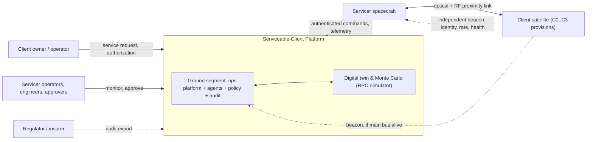
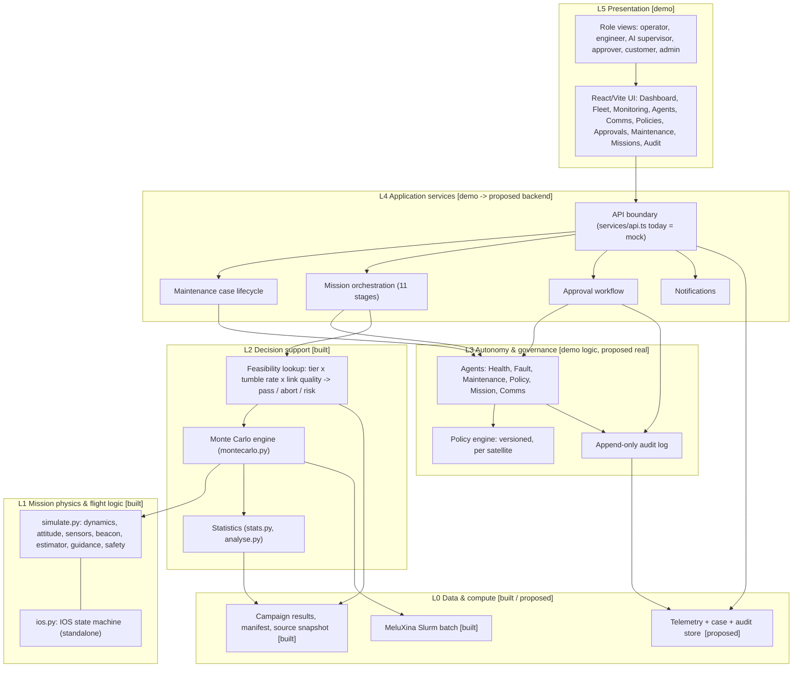
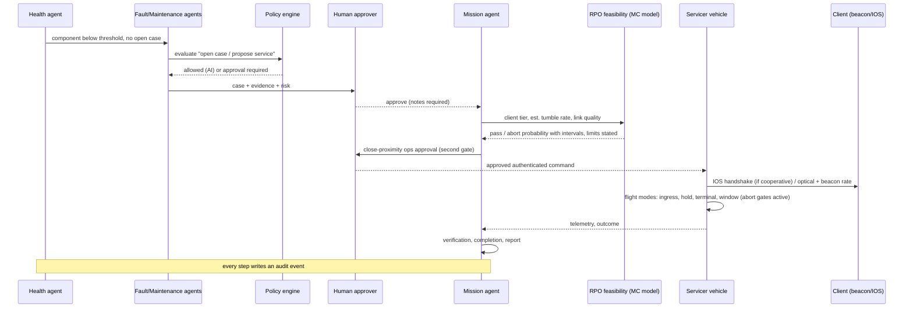

# Target system architecture — Serviceable-Client Platform

**Status:** proposed target architecture (19 Oct 2026). It joins two things that exist today but are not connected: the RPO Monte Carlo simulator (`rpo_project/`, real code, tested) and the operations-platform demo (`satellite-ops-platform/`, frontend-only, fabricated data). Boxes are tagged **[built]**, **[demo]** or **[proposed]**. Nothing here claims flight hardware, ClearSpace endorsement or validated operations.

## 1. Idea in one paragraph

A servicer operator needs to decide *whether, when and how* to service a client satellite. The platform watches client health, diagnoses a fault, checks policy, asks a human to approve risky steps, plans the mission, and uses the RPO model to judge whether the approach is feasible for that client's preparation tier (C0–C3). Client-side provisions (fiducials, independent beacon, IOS mode) are what let the same loop keep working when the client is degraded. Humans keep authority over every high-risk action.

## 2. System context

## 3. Layered architecture

**Design rules**
1. Agents propose; humans approve anything high-risk (close-proximity ops, component replacement, hazardous command, config change). Already enforced in the demo store.
2. Flight-side logic sees estimates only; truth is for scoring (already enforced in `simulate.py`).
3. Every decision, policy evaluation and approval writes an audit record with the policy version.
4. The mock `services/api.ts` is the single seam to replace with a real backend; UI code does not change.
5. Simulation results are evidence with stated limits, never a go/no-go by themselves.

## 4. Concept-to-code map

| Concept | Frontend demo (`satellite-ops-platform/src`) | Simulator (`rpo_project`) | Gap |
|:--|:--|:--|:--|
| Client satellite and components | `Satellite`, `Component` (health, RUL, risk) in `lib/types.ts` | `config/` tiers C0–C3, client geometry | Demo has no tier field; add `serviceTier` to `Satellite` |
| Health detection | Health agent, telemetry series, warn thresholds | none | Telemetry is fabricated |
| Fault → case | `MaintCase`, lifecycle Detected→Completed | none | — |
| Policy | `Policy` (aiAllowed, humanRequired, windows, versions), `PolicyEval` | safety gates in `safety.py` (different meaning: flight abort rules) | Keep both, link by name: ground policy vs flight gate |
| Human approval | `Approval`, role `approver` | IOS authority guards in `ios.py` | Demo approval does not drive IOS state |
| Mission stages | `Mission` 11 stages, incl. "Rendezvous & proximity ops", gated | `simulate.py` flight modes 1–5 | Stage 7 should call feasibility, then hand to flight modes |
| Comms | `CommSession`, `CommMsg` (quality, latency, authorized) | `beacon.py` loss/latency | Demo link values should come from the beacon model |
| Audit | `AuditEvent` | `manifest.json`, replay | Unify: audit references campaign `config_hash` |
| Customer view | role `customer` | tier C0–C3 | Customer sees which provisions their asset has |

## 5. Mission flow (ground ↔ flight)

## 6. Operating modes by client state

| Client state | Navigation inputs | Authority | Platform behaviour |
|:--|:--|:--|:--|
| C3 cooperative | Fiducials + beacon + IOS | IOS handshake, explicit handover | Ground approves handover; IOS guards reject stale or contradictory commands |
| C2 degraded, beacon alive | Fiducials + rate telemetry | Ground only | Normal approach with rate fusion; link loss falls back to C1 |
| C1 unpowered, passive | Fiducials only | Ground only | Lower pass rate at high tumble; policy may require lower rate limit |
| C0 unprepared | Camera only | Ground only | Highest abort rate; policy may refuse approach above a validated envelope |

## 7. Failure handling

| Failure | Detect | Response | Owner |
|:--|:--|:--|:--|
| Telemetry anomaly | Health agent threshold | Open case, notify, no action without policy check | Agents |
| Policy denies action | Policy engine | Block, log, show reason | Policy |
| Approver rejects | Approval status | Agents stand down; case/mission blocked | Approval |
| Beacon loss or stale packet | Packet age, sequence | Drop to optical-only tier; estimate covariance grows; covariance gate may abort | `beacon.py`, `safety.py` |
| Estimate degrades near client | Position-covariance gate | Abort, active retreat with reserve fuel | `safety.py` |
| Retreat estimate mismatch | Truth vs estimate (sim) | Counted separately; not a success | analysis |
| Ground link lost | Heartbeat timeout | Hold / safe state; no new commands accepted | IOS/servicer **[proposed]** |
| Conflicting authority | IOS state machine | Reject, keep last safe state | `ios.py` |

## 8. Technology and deployment

| Layer | Today | Target |
|:--|:--|:--|
| UI | React, Vite, Tailwind, Zustand, localStorage | Same UI, real auth (OIDC) in place of role switch |
| Backend | none (`services/api.ts` mock) | Python (FastAPI) service wrapping `rpo_project`; Postgres for cases, audit, telemetry; append-only audit table with hash chain |
| Agents | deterministic scripted ticks | Rule-based first, LLM-assisted proposals later, always behind policy and human gates |
| Simulation | CLI, Slurm on MeluXina | Same code run as batch jobs; results indexed by `config_hash`; interactive pilot (30 runs ≈ 1 min) for what-if |
| Security | none | Authenticated, replay-protected commands (CCSDS SDLS-style **[verify]**), RBAC, signed audit export |

## 8b. Satellite-side logs and audits (downlink)

`onboard/recorder.py` is the part meant to run **on the satellite** (standard library only, no numpy or web framework). It keeps a bounded buffer of hash-chained records (audit, critical event, event, housekeeping), sends them only during contact passes in priority order within the pass byte budget, retries lost packets until acknowledged, drops housekeeping first when full (audit last) and leaves a visible sequence gap for any drop. The ground side recomputes every hash and checks the chain. The dashboard page **Logs & Downlink** shows, per satellite, when records were created, first sent and received, how long delivery took, which passes were held or missed, and what was dropped. Data come from `python tools/export_downlink_demo.py` (24 simulated hours; traffic, link rates, loss and outages are assumptions). The hash chain is tamper-evident, not a signature; flight use needs authenticated signing.

## 8c. Fuel measurement

`onboard/fuel.py` (stdlib only) gauges propellant two independent ways and fuses them. **Book-keeping** integrates commanded burns through the rocket equation; its error grows with use because the true Isp differs from nominal. **PVT** reads tank pressure and temperature: helium is a fixed amount, so ullage volume is n·R·T/P and propellant is what remains; its error follows the ullage, so it is best when the tank is full. A 3-state filter (mass, Isp bias, PVT bias) predicts with book-keeping, corrects with PVT, and reports a 1σ. Persistent disagreement raises a flag (leak or pressure-sensor fault), after which the filter stops learning from PVT and the dashboard plans on the lowest of the three figures. Outputs: propellant ±σ, remaining Δv, run rate, years of operational Δv above the disposal reserve, and a refuel/replacement candidate alert, which feeds the refuel-and-release option in [ECONOMICS_MODEL.md](ECONOMICS_MODEL.md). On 200 simulated years without faults the fused error is about 1.2 kg RMS (800 kg start), its ±2σ band covered the truth about 99% of the time, and 6% of runs raised a false flag; a 0.05 kg/day leak was flagged in all 100 runs (median 35 days) and a stuck pressure sensor in all 100 (median 6 days). Page: **Fuel Measurement**, data from `python tools/export_fuel_demo.py`. Tanks, loads, burn schedules, sensor accuracies, reserves and the two injected faults are assumptions; the cause message is a heuristic, not a diagnosis.

## 9. Build path and status

| Step | Deliverable | Status |
|:--|:--|:--|
| 1 | `serviceTier` / `estTumbleDegS` on frontend `Satellite`, seeded per customer (demo values) | **Done** (`lib/types.ts`, `data/seed.ts`) |
| 2 | Feasibility table exported from campaign (`tools/export_feasibility.py` → `data/feasibility.json`) and shown on the Missions page (`FeasibilityCard`) | **Done**; out-of-range tumble rates are flagged, no interpolation |
| 3 | FastAPI service `platform_api/`: `/feasibility`, `/feasibility/tiers`, `/audit`, `/audit/verify`, `/health` | **Done**, 6 tests; cases, approvals and missions are **not** yet server-side |
| 4 | UI mirrors cases, approvals, missions, satellite tiers (`PUT /sync`) and every audit event (`POST /audit`) to the server when `VITE_API_URL` is set | **Done** (`startBackendMirror`). The browser store is still the interactive source in demo mode; it is not yet replaced by server reads |
| 4b | Server-side rules: only approvers decide, notes required, gate approval before a mission leaves a stage, feasibility before rendezvous, role check on advance | **Done**, `platform_api/domain.py`, tested. The UI now asks the server first (`serverGuard` in `api.ts`) and shows its refusal; if the server is unreachable it falls back to the same local rules. Autonomous agents still advance missions inside the store and bypass the server |
| 5 | `ios.py` coupled to the RPO loop: ground approval → IOS permit → (C3) physical detumble → RPO run → handover/mate/release, or abort from the current IOS state; server runs this at the rendezvous gate | **Done**, `rpo_project/ios_coupling.py`, 8 tests. Latch/load-path are inputs (no contact model); credential is a simulation token |
| 6 | Beacon bench | **Planned, not built**: survival sizing, bench tests B1–B7 with model-derived limits, virtual bench in [BEACON_BENCH_PLAN.md](BEACON_BENCH_PLAN.md). No hardware measurements exist |
| 7 | Costed economics and break-even by tier | **First pass on assumptions**: [ECONOMICS_MODEL.md](ECONOMICS_MODEL.md). Every price, mass and probability is assumed; only outcome probabilities, Δv and propellant come from the simulator |

Run: `pip install -r requirements-platform.txt && uvicorn platform_api.app:app --port 8000`, then `VITE_API_URL=http://localhost:8000 npm run dev` in `satellite-ops-platform/`. Refresh the table after a new campaign: `python tools/export_feasibility.py results/<campaign>`.

See also [SCOPE_ARCHITECTURE.md](SCOPE_ARCHITECTURE.md) for the architecture derived from the Phase 2 decks and guide (client states, layered elements, product tiers, workstreams, roadmap).

## 10. Honest limits

The ground platform is a concept demo with fabricated data and scripted agents. The simulator is low-to-medium fidelity with no contact model. Linking them (steps 1–4) is software work; steps 5–7 need new physics, hardware or cost data. The architecture is a design target for the proposal, not a validated system.
