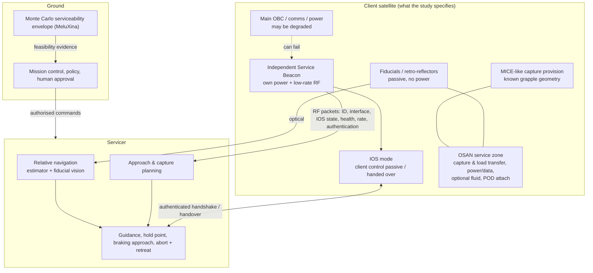

# Scope architecture — derived from the Phase 2 documents

**Sources:** [Phase2_Serviceability.pptx](reference/Phase2_Serviceability.pptx) ("deck A", 12 slides), [Phase2_ClearSpace_Call.pptx](reference/Phase2_ClearSpace_Call.pptx) ("deck B", 12 slides), [Project Guide PDF](reference/Orbit_Observers_RPO_Monte_Carlo_Project_Guide.pdf) (Rev A, 15 Oct 2026). This document starts from *what the study was asked to show* and only then maps to code. For the software/ground layering see [PLATFORM_ARCHITECTURE.md](PLATFORM_ARCHITECTURE.md); for the simulator see [SYSTEM_ARCHITECTURE.md](SYSTEM_ARCHITECTURE.md).

## 1. The question the architecture must answer

> *What minimum client-side features allow a satellite to remain serviceable in every state?* — "Design for the worst day in orbit, not the best one." (deck A, slide 3)

Success is stated as: *for a representative GEO client and explicit uncertainties, identify the failure/rotation regimes where passive preparation, independent state data and active IOS cooperation materially change servicing feasibility, and turn that into requirements and a staged product roadmap* (Guide §18). The goal is explicitly **not** another docking port (deck A, slide 12) and not a detailed universal interface (deck B, slide 8).

## 2. Three client states × five layered elements

Each element keeps the satellite serviceable one step further as it degrades (deck A, slide 4). Naming map: deck cases A0–A3 = repo tiers C0–C3.

| Client state (deck A, s3) | What still works | Element that carries serviceability | Case | Repo evidence |
|:--|:--|:--|:--|:--|
| **Nominal / cooperative** — healthy, attitude-controlled, communicating | Bus, comms, attitude control | **IOS mode** (control handover), authenticated beacon, planned interfaces | A3 / C3 | `ios.py` state machine; C3 sim with physical detumble (`ios_coupling.py`) |
| **Degraded / partially cooperative** — partial OBC, power or comms failure | Independent beacon power and RF; passive aids | **Independent Service Beacon** (rate, ID, health, IOS state, authentication) | A2 / C2 | `beacon.py`, C2 studies, [bench plan](BEACON_BENCH_PLAN.md) |
| **Non-cooperative / tumbling** — no control or comms | Nothing powered | **Fiducials** (relative navigation, no power) + **MICE-like capture provision** (known geometry) | A1 / C1 (A0 / C0 = none) | C0 vs C1 campaign; capture geometry is shared by all tiers, so the capture-fixture benefit is **not** isolated |
| **All states, high-value platforms** | — | **OSAN**: capture/load transfer, power/data, optional fluid, POD attachment | n/a | functional concept only; cost in [ECONOMICS_MODEL.md](ECONOMICS_MODEL.md) §7 |

Fall-back chain when power is lost completely: beacon → fiducials/retro-reflectors → known capture geometry → prepared EOL provisions (Guide §15). The simulator exercises the first three links (C2 → C1 → C0 behaviour on beacon loss).

## 3. Layered serviceability architecture

## 4. Product family logic (deck A s2, deck B s2 and s9; Guide §16)

"Not one universal interface for all satellites. Instead a configurable product family based on mission value and orbit."

| Asset class | Serviceability provision (deck) | Product tier (deck B s9) | Cumulative provisions | Servicing option it enables (Guide §16) |
|:--|:--|:--|:--|:--|
| LEO / low-value | End-of-life capture and removal | 1 EOL-ready | MICE-like capture + fiducials | Removal |
| High-value GEO | Docking, refuelling, health monitoring | 2 Service-ready | + IOS mode + communication (beacon) | MEV-style attached propulsion |
| Long-life assets | Upgrade / propulsion PODs | 3 Life-extension-ready | + refuelling / propulsion augmentation | Refuel-and-release, propulsion POD |
| Future platforms | Interoperable architecture | 4 Augmentation-ready | + power/data + upgrade POD (OSAN) | Upgrade POD |

Servicing-option preconditions from the Guide: **MEV-style attached** needs compatible mechanical capture and a servicer committed to the client; **refuel-and-release** needs healthy valves/tanks/feed plus a qualified fluid connector; **propulsion POD** needs structural attachment and coupled orbit/attitude control; **upgrade POD** needs power/data/thermal/software interfaces; **removal** needs prepared capture and authorised disposal. Per-tier cost: [ECONOMICS_MODEL.md §7](ECONOMICS_MODEL.md).

### GEO platform evolution (deck B s7)

| Generation | Capture features available | Design consequence |
|:--|:--|:--|
| Legacy chemical | Nozzle / ring usable (as MEV did) | Accidental interfaces exist |
| Hybrid | Fewer legacy features | Partial reliance |
| All-electric | None incidental | A **deliberate, propulsion-independent** service interface is required |

Our model uses one fixed capture point (1.5 m from the centre). Whether the capture feature is deliberate or accidental is therefore **outside the simulator**; it is a question for ClearSpace (deck B s7).

## 5. Service Beacon: required content → packet → code

Deck A slide 5 lists six data items. Proposed packet (sizes are design assumptions):

| Deck item | Field | Bytes | In `beacon.py` / `ios.py` today? |
|:--|:--|--:|:--|
| Version / framing | version | 1 | no |
| Satellite ID (identity, owner, mission) | client_id | 4 | yes (identity flag) |
| — | timestamp | 4 | yes |
| — | sequence | 2 | partly (IOS sequence_id) |
| Angular-rate estimate | rate + uncertainty | 3 | yes (rate + noise) |
| Interface location / type | interface_id | 1 | **no** |
| IOS state | ios_state | 1 | yes (`IOSState`, separate from the beacon) |
| Basic health flags (power, thermal, propulsion) | health | 1 | **no** |
| Authentication status | auth tag | 8 | flag only (shared token; no crypto) |
| — | CRC | 2 | no |
| **Total** | | **27** | |

27 bytes = 216 bits; at the assumed 19.2 kbit/s this is 11.3 ms of air time, consistent with the 15 ms transmit slot used in the power budget (preamble and guard add the rest). Two content items are specified but unmodelled: *interface location/type* and *health flags*. They affect planning, not the RPO dynamics, so adding them to the packet changes no campaign result.

## 6. IOS state flow (deck A s6) and the abort rule

Normal → Service Standby → Approach Permitted → IOS Mode → Mated/Servicing → Verification → Release → Normal. **ABORT is reachable from any state once servicing starts**: the client returns to a safe, predictable attitude and the servicer retreats on a passively safe trajectory.

| Requirement from the deck | Where it lives | Status |
|:--|:--|:--|
| Client must not fight the servicer (single authority) | `IOSStateMachine.check_authority_invariant` | tested |
| Authenticated "go" for RPO | token + sequence + freshness guards; ground approval gate in `ios_coupling.py` and `platform_api/domain.py` | token is a simulation credential, not cryptography |
| Abort from any servicing state | `ABORT_SAFE` transitions, ack-timeout, docked-abort keeps stack authority | tested |
| Servicer retreats on a **passively safe** trajectory | active retreat to a standoff, propagated in v4.1 | passive safety **not** established (stated in the v4.1 report) |
| Coupling to approach outcome | `ios_coupling.run_ios_servicing_episode` | **new**: aborts when RPO aborts, refuses handover above 3.25°/s, C3 spin comes from a physical detumble |

## 7. Six workstreams → components (deck A s10, Guide §18)

| # | Workstream | Definition of done (Guide) | Component in repo | Status |
|:--|:--|:--|:--|:--|
| 1 | Systems / OSIP proposal | One consistent scope, scenario list, risk/TRL/roadmap | `docs/PHASE2_PROPOSAL.md`, this document | draft; not approved by ClearSpace |
| 2 | RPO / GNC | Validated single-case simulations and tests | `dynamics`, `attitude`, `sensors`, `estimator`, `guidance`, `safety`, `simulate` | 60 tests; cross-check in Basilisk (V4) **not done** |
| 3 | HPC / stats | Reproducible envelopes with CIs and diagnostics | `montecarlo`, `stats`, `analyse`, `hpc/` | done for the studied grid |
| 4 | Beacon / comms | Data fields, mode/packet model, survival trade | `beacon.py`, `bench.py`, [BEACON_BENCH_PLAN.md](BEACON_BENCH_PLAN.md) | packet spec and bench plan; **no hardware** |
| 5 | IOS / docked + OSAN | CONOPS + hazard/abort and interface allocation | `ios.py`, `ios_coupling.py` | IOS coupled; OSAN layout/loads **not** done |
| 6 | Economics / regulation | Market assumptions, burden/value trade, adoption plan | `economics.py`, [ECONOMICS_MODEL.md](ECONOMICS_MODEL.md) | assumption-based first pass |

## 8. Expected results the deck asks for (deck A s7–8, s11)

| Deck metric | Direction | Repo column / output |
|:--|:--|:--|
| Capture success | maximise | `terminal_pass` (terminal window; **not** physical capture) |
| Abort rate | minimise | `aborted`, `abort_reason` |
| Collision risk | minimise | `unsafe`, `minimum_clearance_m` |
| ΔV | minimise | `delta_v_mps`, retreat Δv |
| Capture time | minimise | `elapsed_s`, time to capture |
| Robustness vs tumbling | maximise | pass rate vs tumble (studies `main`, `envelope`) |
| Varied inputs: tumble, nav noise, packet loss, latency, initial attitude, control uncertainty | — | all six are dispersed or swept (`main`, `ablation`, `envelope`, `latency`) |
| Output: probability map / "feasible vs not feasible" | — | `plot3_2d_servicing_envelope.png`; platform feasibility card |

## 9. OSIP proposal structure → evidence (deck A s11; Guide §17)

| Section | Evidence in repo | Gap |
|:--|:--|:--|
| Executive summary | `PHASE2_PROPOSAL.md` §1 | needs ClearSpace agreement |
| Need & state of the art | `PHASE2_PROPOSAL.md` §2, [EXPERT_CHECKPOINT_SESSION1.md](EXPERT_CHECKPOINT_SESSION1.md) Q5 | sourced comparison (MICE/MASI/ASSIST, MEV, others) still to do |
| Innovation vs existing | degraded-state serviceability, not a port | needs the comparison above |
| Objectives | requirements RPO-01..04, BEACON-01, IOS-01, OSAN-01, ECON-01 | targets to be agreed |
| Technical approach / WPs | six work packages | owners and dates to be agreed |
| Expected results | envelopes, minimum beacon fields (§5), IOS machine, requirements trace | hardware validation |
| Risks & mitigation | `PHASE2_PROPOSAL.md` risk register | regulatory section incomplete (see checkpoint Q4) |
| Roadmap | §10 below | costs are assumptions |

## 10. Roadmap and gates (deck A s11, deck B s11; Guide §17 "Implementation")

| Stage | Content | Entry / exit evidence | Indicative cost basis |
|:--|:--|:--|:--|
| **Study (Phase 2)** — now | Simulation envelopes, beacon/IOS concept, OSAN generic layout, tier trade study | Reviewer agrees scope and targets; hold-out campaign meets per-cell targets | existing effort |
| **Ground demo** | Software-in-loop → ground comms/controller demo → bench beacon (B1–B7) → HIL / contact tests | Bench PASS on all of B1–B7; contact model validated against a rig | beacon bench ≈ €205 k (assumed, [BEACON_BENCH_PLAN.md §6](BEACON_BENCH_PLAN.md)) |
| **IOD** (in-orbit demonstration) | Prepared client + servicer rendezvous | Ground demo gates met; owner/operator consent and national authorisation | **not estimated** |
| **Product family** | Tiers 1–4 as catalogue items | IOD result; cost–benefit per tier positive for target clients ([ECONOMICS_MODEL.md](ECONOMICS_MODEL.md)) | tier unit costs, same assumptions |

## 11. Questions for ClearSpace carried by the decks (deck B s3–s10)

1. Is degraded / cooperative serviceability a meaningful operational gap?
2. Which scenario and assumptions (non-cooperative, degraded) are most useful?
3. Would a Service Beacon / IOS mode help real operations, or should other problems come first?
4. How does the chemical → hybrid → electric GEO transition change interface strategy?
5. Generic OSAN service zone, or a detailed interface design?
6. Which tier (EOL-ready … augmentation-ready) matters most to ClearSpace's market view?
7. What should the OSIP proposal contain to be most useful?

## 12. What this changes in the platform

* Client state (nominal / degraded / non-cooperative) and tier should be first-class fields on a satellite; today the UI has `serviceTier` and `estTumbleDegS`.
* The "Rendezvous & proximity ops" mission stage now has a server-side rule chain: feasibility before leaving planning, a human-approved gate before leaving rendezvous, then the IOS/RPO episode ([domain.py](../platform_api/domain.py)).
* Open: interface location/type and health flags in the beacon model; a deliberate-versus-accidental capture-feature parameter for the GEO evolution question; OSAN loads and layout.
