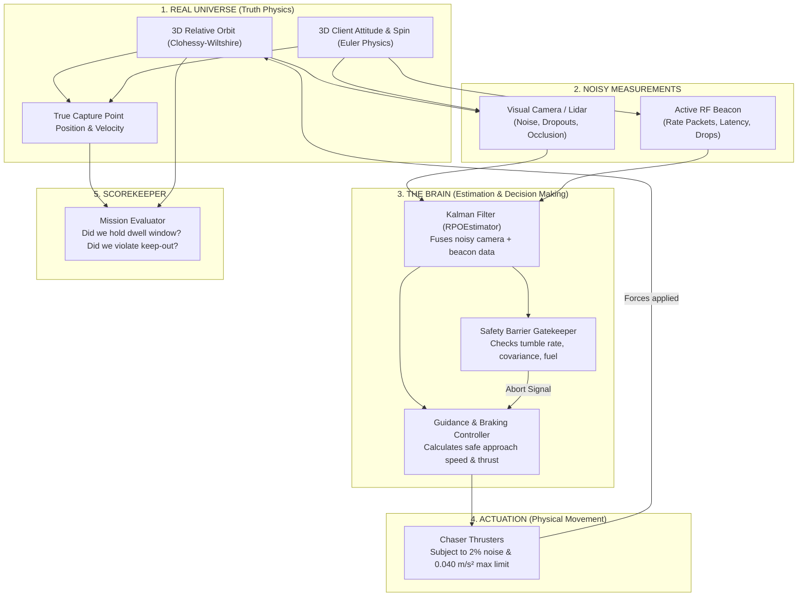
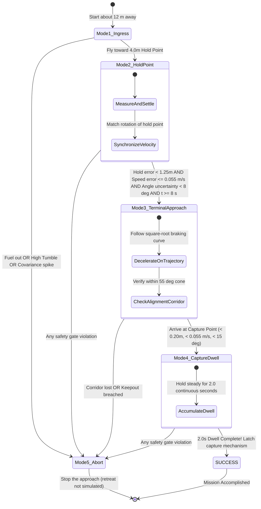

# System Architecture & Design Guide: In-Orbit Servicing & RPO

**Audience:** Engineers, Researchers, and Students with **Zero Prior Aerospace or Control System Background**  
**Document ID:** SYS-DES-2026-V4 (model `Phase2-RPO-MC-v4.0`)  
**Project:** Orbit Observers / ClearSpace Phase 2 — Autonomous Rendezvous & Proximity Operations (RPO)  

---

## Table of Contents
1. [The Big Picture: What Are We Trying to Do?](#1-the-big-picture-what-are-we-trying-to-do)
2. [High-Level Architecture Diagram](#2-high-level-architecture-diagram)
3. [The 5 Operational Flight Modes](#3-the-5-operational-flight-modes)
4. [Step-by-Step Subsystem Walkthrough](#4-step-by-step-subsystem-walkthrough)
   - [Subsystem 1: The True Physics World (`dynamics.py`, `attitude.py`)](#subsystem-1-the-true-physics-world)
   - [Subsystem 2: Sensors & Independent RF Beacon (`sensors.py`, `beacon.py`)](#subsystem-2-sensors--independent-rf-beacon)
   - [Subsystem 3: The State Estimator / Kalman Filter (`estimator.py`)](#subsystem-3-the-state-estimator--kalman-filter)
   - [Subsystem 4: Guidance & Braking Controller (`guidance.py`)](#subsystem-4-guidance--braking-controller)
   - [Subsystem 5: Autonomous Safety Barriers (`safety.py`)](#subsystem-5-autonomous-safety-barriers)
   - [Subsystem 6: The Monte Carlo Layer (`montecarlo.py`, `analyse.py`, `stats.py`, `replay.py`)](#subsystem-6-the-monte-carlo-layer)
5. [The Science in Plain English](#5-the-science-in-plain-english)
6. [Client Preparation Tiers ($C_0$ to $C_3$)](#6-client-preparation-tiers-c0-to-c3)
7. [Glossary of Terms](#7-glossary-of-terms)

---

## 1. The Big Picture: What Are We Trying to Do?

Imagine two cars driving on a highway at 11,000 km/h (Geostationary Orbit). 
- **Car A (The Target/Client):** A dead or aging communications satellite. It is floating uncontrollably and **tumbling** (spinning like a top). It has a special door handle (the **Capture Point / Grapple Fixture**) sticking out $1.5\text{ meters}$ from its center.
- **Car B (The Chaser/Servicer):** Our active robotic space tug. Its mission is to fly up to the spinning satellite, match its rotation, reach within 20 centimeters of the door handle with nearly zero relative speed, and hold steady for at least 2 seconds so a robotic gripper can latch on.
- **The Golden Rule:** The Chaser must **never crash** into the client satellite's body (an invisible danger zone called the **Keep-Out Sphere** with a $1.35\text{ meter}$ radius).

```
                 [ The Target Satellite ]
                       (Tumbling)
                         /====\
                        |  ()  |----[Capture Fixture @ 1.5m]
                         \====/        ^
                           |           |  Target Distance: < 0.20m
                     (Keep-Out Zone)   |  Relative Speed:  < 0.055 m/s
                         r=1.35m       v
                                    [Chaser Tug]
                                   (Armed with thrusters
                                    & optical cameras)
```

---

## 2. High-Level Architecture Diagram

The software runs in a closed loop at **4 times per second** ($\Delta t = 0.25\text{ seconds}$). 

Here is how data flows through the system:



---

## 3. The 5 Operational Flight Modes

The mission transitions through a finite state machine with strict safety conditions:



### Mode Breakdown:

| Flight Mode | Operating Distance | Goal | Success Gate to Next Mode |
|:---|:---:|:---|:---|
| **Mode 1: Ingress** | $12.0\text{ m} \to 4.0\text{ m}$ | Close the long-range distance from launch offset toward the standoff position. | Reach within $1.25\text{ m}$ of the rotating $4.0\text{ m}$ hold point. |
| **Mode 2: Standoff Hold** | $4.0\text{ m}$ sphere | Station-keep at a safe standoff distance; allow Kalman filter to converge on attitude and spin rate. | Position error $< 1.25\text{ m}$, speed error $\le 0.055\text{ m/s}$, attitude *uncertainty* (1-σ) $< 8^\circ$, elapsed time $\ge 8\text{ s}$. |
| **Mode 3: Terminal Approach** | $4.0\text{ m} \to 1.5\text{ m}$ | Inward descent toward the moving capture fixture along a narrow alignment cone ($< 55^\circ$). | Reach capture tolerance: position $< 0.20\text{ m}$, speed $< 0.055\text{ m/s}$, alignment $< 15^\circ$. |
| **Mode 4: Capture Dwell** | $1.5\text{ m} \pm 0.2\text{ m}$ | Maintain formation with the moving capture port continuously for $2.0\text{ seconds}$ without slipping. | Dwell counter reaches $2.0\text{ s}$ ($\ge 8$ consecutive time steps). |
| **Mode 5: Abort** | Anywhere | Stop the approach before it becomes dangerous. The simulation ends at the abort decision; the retreat manoeuvre is not simulated. | Estimated spin $> 3.2^\circ/\text{s}$ (after 10 s), attitude uncertainty $> 18^\circ$ (after 12 s), fuel $\ge 2.5\text{ m/s}$, or approach corridor lost inside 2.8 m. |

---

## 4. Step-by-Step Subsystem Walkthrough

### Subsystem 1: The True Physics World
- **Files:** [`rpo_project/dynamics.py`](../rpo_project/dynamics.py), [`rpo_project/attitude.py`](../rpo_project/attitude.py)
- **Role:** Simulates the actual, ground-truth motion of both satellites.
- **How it works:**
  - **Orbital Flight:** In space, objects do not travel in straight lines because Earth's gravity pulls them in an arc. We use the **Clohessy-Wiltshire (CW)** equations with a Runge-Kutta 4th-order (RK4) integrator to calculate where the chaser drifts every quarter of a second.
  - **Client Tumbling:** The target satellite spins freely according to Euler's rigid-body rotational dynamics. We track orientation using **quaternions** (4-element vectors that avoid "gimbal lock" singularities).

### Subsystem 2: Sensors & Independent RF Beacon
- **Files:** [`rpo_project/sensors.py`](../rpo_project/sensors.py), [`rpo_project/beacon.py`](../rpo_project/beacon.py)
- **Role:** Acts as the "eyes and ears" of the chaser tug.
- **Imperfections Modeled:**
  - **Camera Noise:** Camera measurements contain Gaussian noise ($\sigma = 3^\circ$ for cooperative targets, $\sigma = 12^\circ$ for uncooperative targets).
  - **Dropouts & Blinking:** Occasionally ($8\%$ to $30\%$ of the time), image processing fails and drops a frame.
  - **Occlusion:** When the client satellite rotates so the docking port is on the far side, the camera can no longer see the markers.
  - **Service Beacon ($C_2$):** A small radio transmitter on the client satellite that broadcasts its own spin rate $\omega_z$. Packets experience random internet-like drops ($20\%$) and radio latency delays ($100\text{ ms}$).

### Subsystem 3: The State Estimator / Kalman Filter
- **File:** [`rpo_project/estimator.py`](../rpo_project/estimator.py)
- **Role:** The mathematical "lie detector" that turns noisy, flickering camera data into smooth, reliable position and speed estimates.
- **Strict Rule (Information Isolation):** The guidance computer is **blind** to the true physics world. It is only allowed to see what the Kalman Filter estimates.
- **Separated Filter Design:**
  - **Filter A (Translation):** Tracks 3D relative position and 3D velocity ($6\times 6$ covariance).
  - **Filter B (Attitude & Rate):** Tracks client spin angle and angular velocity ($2\times 2$ covariance).
  - **Latency Compensation:** When beacon packets arrive with a time delay, the filter inflates noise proportional to packet age, avoiding stale-data shocks.

### Subsystem 4: Guidance & Braking Controller
- **File:** [`rpo_project/guidance.py`](../rpo_project/guidance.py)
- **Role:** The autopilot pilot steering the engines.
- **The Core Innovation (`braking_pd`):**
  - Older systems (`legacy_pd`) commanded acceleration proportional to distance. When close to the target, the chaser was moving too fast and its small thrusters ($0.040\text{ m/s}^2$) could not brake in time, overshooting into the keep-out zone.
  - `braking_pd` calculates the **kinematic stopping curve**:
    $$v_{\text{approach}} \le \sqrt{2 \cdot (0.50 \cdot a_{\max}) \cdot \text{distance}}$$
  - It intentionally reserves **50% of the engine capacity** solely for braking and rotating feed-forward tracking. This removed the overshoot keep-out violations seen with `legacy_pd` in the v2.1 baseline.

### Subsystem 5: Autonomous Safety Barriers
- **File:** [`rpo_project/safety.py`](../rpo_project/safety.py)
- **Role:** The fail-safe emergency system.
- **Triggers:**
  - **Keep-Out Barrier ($1.35\text{ m}$):** If the chaser penetrates closer than $1.35\text{ m}$ from the target's center, the run is flagged as `UNSAFE`.
  - **Tumble Rate Gate ($> 3.2^\circ/\text{s}$):** If the target is spinning too violently to capture safely, the chaser aborts to avoid getting swatted by solar panels.
  - **Covariance Gate ($> 18.0^\circ$):** If optical sensors lose track and uncertainty becomes too high, the chaser stops moving inward.
  - **Fuel Cap ($2.50\text{ m/s}$):** Ensures the tug retains enough propellant to retreat safely.

---

### Subsystem 6: The Monte Carlo Layer
- **Files:** [`rpo_project/montecarlo.py`](../rpo_project/montecarlo.py), [`rpo_project/analyse.py`](../rpo_project/analyse.py), [`rpo_project/stats.py`](../rpo_project/stats.py), [`rpo_project/replay.py`](../rpo_project/replay.py)
- **Role:** Runs subsystems 1–5 thousands of times and turns the results into evidence.
- **How it works:**
  - **Random inputs, drawn first.** Before a run starts, every random number it will need (starting offset, client orientation and spin axis, sensor noise, packet losses, thruster errors) is drawn from five independent random streams. The client tier only *scales* those numbers, so C0, C1, C2 and C3 face exactly the same "bad luck" on the same seed.
  - **Studies.** Four experiments are defined as data: `main` (tiers vs tumble rate), `ablation` (beacon packet loss × update rate), `envelope` (tumble × camera noise) and `latency` (beacon delay).
  - **Parallel and HPC.** Runs are spread over all CPU cores, or over a Slurm job array in chunks that are merged afterwards. The output is byte-identical however the work is split.
  - **Statistics.** Pass rates carry Wilson 95% confidence intervals; tiers are compared seed-by-seed with the exact McNemar test; a convergence plot shows whether enough runs were made.
  - **Report.** Every campaign writes `report.md`, seven figures, summary tables, a list of failed runs and a `manifest.json` that records exactly how the results were produced.
  - **Replay.** Any single run can be re-flown and plotted from its seed (`python -m rpo_project.replay`).

```
            ┌──────────── for every study, cell and seed (in parallel) ────────────┐
 config ──► │ draw random inputs ─► run tier C0 ─► run C1 ─► run C2 … (same draws) │ ──► runs_<study>.csv
            └──────────────────────────────────────────────────────────────────────┘
                                                                                        │
            report.md · plots · summary/paired/failure tables · manifest.json ◄── analyse ◄┘
```

See [MONTE_CARLO_METHOD.md](MONTE_CARLO_METHOD.md) for the full design and [MODEL_REFERENCE.md](MODEL_REFERENCE.md) for every equation and parameter.

---

## 5. The Science in Plain English

### Why don't satellites fly in straight lines?
On Earth, if you turn off a car's engine, friction stops you. In orbit, there is no air friction, but there is gravity and orbital centrifugal force. If you accelerate forward in orbit, you actually rise to a higher, slower orbit and end up falling behind! The **Clohessy-Wiltshire equations** describe this strange orbital geometry so our autopilot steers in the correct curved path.

### What is a "Paired Seed" in Monte Carlo?
When comparing two car models (e.g. Car A vs Car B), you wouldn't test Car A on a dry sunny road and Car B in a blizzard. You test both on the exact same road conditions. In Monte Carlo, a **random seed** generates specific weather, sensor noise, and starting offsets. We use **paired seeds** so that Tier $C_0$, $C_1$, and $C_2$ face the **exact same randomized turbulence**, ensuring a fair, scientifically rigorous comparison.

### What is the Wilson 95% Confidence Interval?
If you flip a coin 30 times and get 27 heads, does that mean the coin is 90% heads? Not necessarily—there is statistical uncertainty because 30 flips is a small sample. The **Wilson 95% Confidence Interval** draws error bars around our pass rates so researchers know the mathematical bounds of our conclusions.

---

## 6. Client Preparation Tiers ($C_0$ to $C_3$)

To evaluate how much preparation is needed on future satellites to make them serviceable, we compare 4 tiers:

```
[C0: Unprepared]      [C1: Fiducials]       [C2: Service Beacon]   [C3: In-Orbit Servicing]
  (Space Debris)       (Visual Markers)      (Visual + RF Radio)     (Active Assist)
    ______                ______                ______                ______
   |  ??  |              | [X]  |              | [X]  | ((o))        | [X]  | ((o))
   |______|              |______|              |______|              |______|
No markers, 12 deg     High-contrast         Fiducials + RF data   Robotic grapple,
camera noise, 30%      markers, 3 deg        beacon streaming      beacon, active
dropouts. Hardest.     camera noise.         spin rate. Robust.    detumbling. Easiest.
```

---

## 7. Glossary of Terms

- **$\Delta V$ (Delta-V):** The total velocity change expended by burning thrusters, measured in meters per second (m/s). This is the "fuel tank" measurement in orbital mechanics.
- **GEO (Geostationary Earth Orbit):** Orbit at an altitude of approximately $35,786\text{ km}$ above Earth's equator where orbital period matches Earth's rotation (24 hours).
- **LVLH (Local-Vertical Local-Horizontal):** The standard rotating coordinate frame used for rendezvous. $X$ points radially outward from Earth, $Y$ points in the direction of orbital travel, and $Z$ points perpendicular to the orbit plane.
- **Keep-Out Sphere (KOS):** A spherical safety bubble around the target satellite ($1.35\text{ m}$ radius) that the chaser must never breach.
- **Capture Dwell Window:** The requirement to remain within the terminal box ($< 0.20\text{ m}$ position error, $< 0.055\text{ m/s}$ speed error, $< 15^\circ$ angle error) continuously for at least $2.0\text{ seconds}$ before mechanical contact is attempted.
